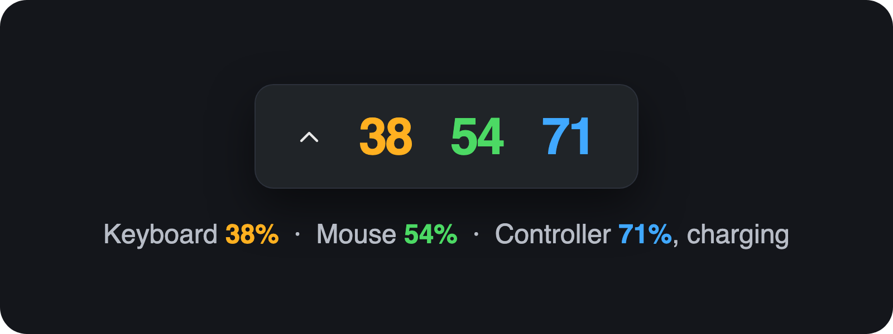

# battray

[](https://github.com/forkacper/battray/releases/latest)
[](https://github.com/forkacper/battray/releases)
[](https://github.com/forkacper/battray/actions/workflows/build.yml)
[](LICENSE)

**Battery level of your wireless mouse, keyboard and controller in the Windows tray.**
battray is a tiny, open source battery monitor for wireless peripherals: Logitech
mice and keyboards, Keychron keyboards, PlayStation DualSense and DualShock 4,
Xbox controllers and Bluetooth devices, all in one place, without G HUB, Steam or
any other vendor software.



## Features

- **Super lightweight**: native Win32 in Rust, a single exe of about 260 KB, a few MB
  of RAM, idle between polls. No installer, no runtime, no background services.
- **One app for every brand**: shows all your wireless devices together, over
  2.4 GHz receivers, Bluetooth and USB.
- **Your choice of tray display**: one icon with the lowest battery, one icon per
  device, or a single device you pick.
- **Colour-coded levels**: green, amber and red, blue while charging.
- **Low battery alerts**, adjustable refresh interval and start with Windows.
- **Private**: no network access, no telemetry, no account.

## Supported devices

| Family | Connection |
|---|---|
| Logitech HID++ 2.0 mice and keyboards (G PRO X SUPERLIGHT, G502, MX Master and more) | Lightspeed, Unifying or Bolt receiver, USB |
| Sony DualSense, DualSense Edge, DualShock 4 | Bluetooth, USB, Sony wireless adapter |
| Xbox controllers and other XInput gamepads | Xbox Wireless Adapter, Bluetooth |
| Keychron wireless keyboards (K Max, Q Max, V Max and more) | 2.4 GHz dongle, Bluetooth, USB, with a [firmware patch](firmware/keychron) |
| Bluetooth headsets, mice, keyboards and other devices that report their battery to Windows | Bluetooth |
| Any HID device with the standard Battery Strength report | Any |

See [DEVICES.md](DEVICES.md) for details and which devices are confirmed on real hardware.

## Install

1. Download `battray.exe` from the [latest release](https://github.com/forkacper/battray/releases/latest).
2. Run it. The battery level shows up in the tray; right-click it for settings.
3. Optionally enable **Start with Windows** in the tray menu.

Or with [Scoop](https://scoop.sh):

```
scoop bucket add battray https://github.com/forkacper/battray
scoop install battray
```

Requires Windows 10 or 11. Settings and logs are kept in `%APPDATA%\battray`.

## FAQ

**How do I check my Logitech mouse battery without G HUB?**
Run battray. It talks to Logitech devices directly over HID++, the protocol G HUB
uses, so G HUB can be uninstalled or closed. It also works with G HUB running.

**How do I see the DualSense or DualShock 4 battery on Windows?**
Windows does not show it, but battray does, over Bluetooth or USB, without Steam or
DS4Windows.

**Why doesn't my Keychron keyboard show its battery on the 2.4 GHz dongle?**
Keychron's stock firmware does not send the battery level over the dongle. Flash the
patched firmware from the release (`keychron-battray-firmware.zip`), see
[firmware/keychron](firmware/keychron). Over Bluetooth it works with stock firmware.

**Windows SmartScreen warns about the exe.**
The exe is not code signed yet. Choose *More info* and *Run anyway*, or build it
yourself with `cargo build --release`.

**My device is not listed.**
Choose *Save diagnostics report* in the tray menu and
[open a device report](https://github.com/forkacper/battray/issues/new?template=device-report.yml)
with it attached.

## Contributing

Contributions are welcome, especially support for new devices. Each device family is
one provider in `src/devices/`. Open an issue or a pull request, and add your change
to the Unreleased section of the [changelog](CHANGELOG.md).

## License

[MIT](LICENSE), except `firmware/`, which is GPL-2.0-or-later like the QMK code it patches.
